<div align="center">


# PractiCal

**Calendar, contacts and tasks for your own server — a fast, modern web app on top of RustiCal.**

[](https://gitlab.com/xarif/docker/practical/-/tags)
[](LICENSE)
[](build/Cargo.toml)
[](build/locales)

<a href="docs/gallery/03-month.md"></a>

</div>

PractiCal is a self-hosted web app for calendars, contacts and tasks with [RustiCal](https://github.com/lennart-k/rustical)
as its backend. Phones and desktop apps keep syncing over CalDAV/CardDAV, and the browser gets a complete, fast UI on
the very same data.

## Why PractiCal

<table>
<tr>
<td width="50%" valign="top">

✨ **Modern, clean interface**<br>
Light and dark, desktop and phone, trackpad and touch gestures — in English, German, French and Spanish.

</td>
<td width="50%" valign="top">

⚡ **Extremely fast and frugal**<br>
Written in Rust. About 13 MiB of memory and a fraction of a millicore in production; one 27 MB image carries
PractiCal and RustiCal.

</td>
</tr>
<tr>
<td valign="top">

🔎 **Powerful search across everything**<br>
One search box for events, contacts and tasks — with dates, prefixes and a search history.

</td>
<td valign="top">

🧩 **Configurable templates for events and tasks**<br>
Rules per category pre-fill or lock colour, reminders, location, priority and more; earlier events serve as title
templates.

</td>
</tr>
<tr>
<td valign="top">

🗓️ **Great views for calendar, tasks and contacts**<br>
Day, week, month, year planner, free weekends, vacation planner, countdown wall, year in numbers; task groups,
table, board, timeline and cards; contacts as list or table.

</td>
<td valign="top">

🎨 **Smart colour manager**<br>
Every colour in one place, and an optimiser that unifies what belongs together and pulls apart colours that are
hard to tell apart — every change shown with its reason before it is applied.

</td>
</tr>
<tr>
<td valign="top">

🏖️ **Public and school holidays**<br>
Per region, in every view, and counted by the vacation planner.

</td>
<td valign="top">

↩️ **And more**<br>
Change history with undo for every change (also from phones), shared group calendars, app tokens per device,
`.ics`/`.vcf` import and export, push reminders, live updates. [All features →](docs/features.md)

</td>
</tr>
</table>

## Gallery

Click a picture to open it large, then page through all screenshots with ◀ ▶ (demo data).

<h3>Calendar</h3>
<table>
<tr>
<td align="center" width="25%"><a href="docs/gallery/01-day.md">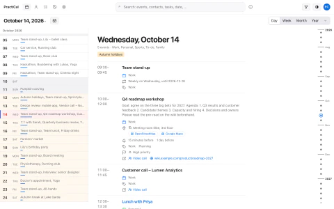</a><br><sub>Day view</sub></td>
<td align="center" width="25%"><a href="docs/gallery/02-week.md">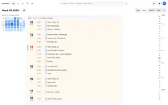</a><br><sub>Week view</sub></td>
<td align="center" width="25%"><a href="docs/gallery/03-month.md">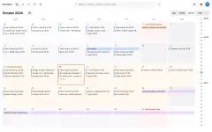</a><br><sub>Month view</sub></td>
<td align="center" width="25%"><a href="docs/gallery/04-year-planner.md">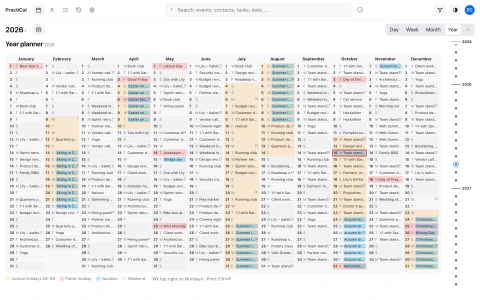</a><br><sub>Year planner</sub></td>
</tr>
<tr>
<td align="center" width="25%"><a href="docs/gallery/05-free-weekends.md">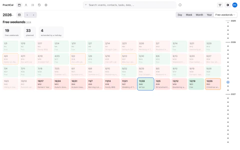</a><br><sub>Free weekends</sub></td>
<td align="center" width="25%"><a href="docs/gallery/06-vacation-planner.md">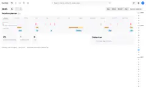</a><br><sub>Vacation planner</sub></td>
<td align="center" width="25%"><a href="docs/gallery/07-countdown.md">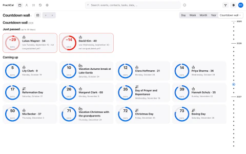</a><br><sub>Countdown wall</sub></td>
<td align="center" width="25%"><a href="docs/gallery/08-year-in-numbers.md">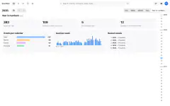</a><br><sub>Year in numbers</sub></td>
</tr>
</table>

<h3>Tasks</h3>
<table>
<tr>
<td align="center" width="25%"><a href="docs/gallery/09-tasks-list.md">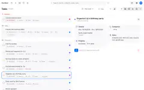</a><br><sub>Task list</sub></td>
<td align="center" width="25%"><a href="docs/gallery/10-tasks-table.md">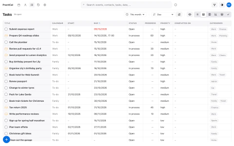</a><br><sub>Task table</sub></td>
<td align="center" width="25%"><a href="docs/gallery/11-tasks-board.md">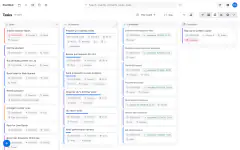</a><br><sub>Task board</sub></td>
<td align="center" width="25%"><a href="docs/gallery/12-tasks-timeline.md"></a><br><sub>Task timeline</sub></td>
</tr>
<tr>
<td align="center" width="25%"><a href="docs/gallery/13-tasks-deck.md">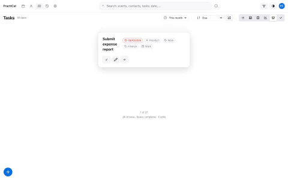</a><br><sub>Task deck</sub></td>
<td align="center" width="25%"><a href="docs/gallery/14-tasks-done.md">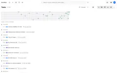</a><br><sub>Completed tasks</sub></td>
</tr>
</table>

<h3>Contacts</h3>
<table>
<tr>
<td align="center" width="25%"><a href="docs/gallery/15-contacts-list.md">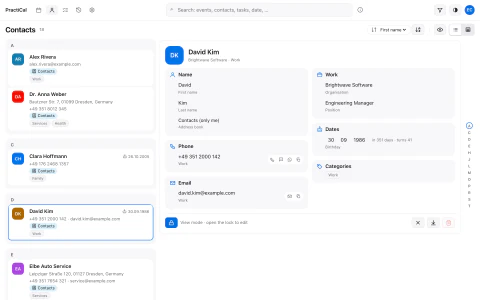</a><br><sub>Contacts</sub></td>
<td align="center" width="25%"><a href="docs/gallery/16-contacts-table.md">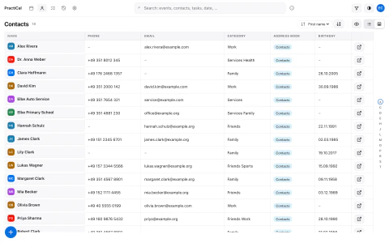</a><br><sub>Contacts table</sub></td>
</tr>
</table>

<h3>Editors — view and edit mode</h3>
<table>
<tr>
<td align="center" width="25%"><a href="docs/gallery/17-event-view.md">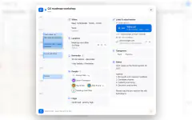</a><br><sub>Event (view mode)</sub></td>
<td align="center" width="25%"><a href="docs/gallery/18-event-edit.md">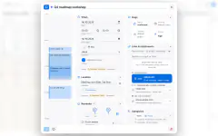</a><br><sub>Event (edit mode)</sub></td>
<td align="center" width="25%"><a href="docs/gallery/19-task-view.md">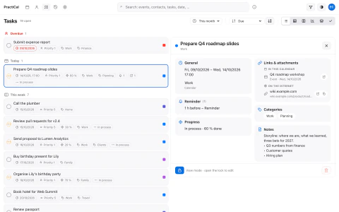</a><br><sub>Task (view mode)</sub></td>
<td align="center" width="25%"><a href="docs/gallery/20-task-edit.md">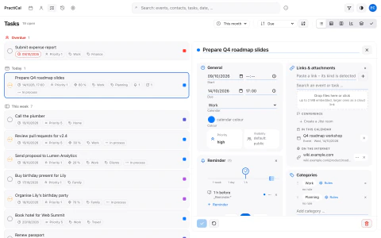</a><br><sub>Task (edit mode)</sub></td>
</tr>
<tr>
<td align="center" width="25%"><a href="docs/gallery/21-contact-view.md">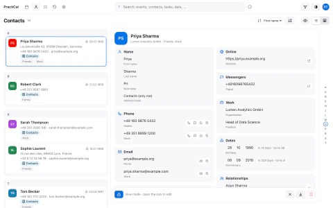</a><br><sub>Contact (view mode)</sub></td>
<td align="center" width="25%"><a href="docs/gallery/22-contact-edit.md">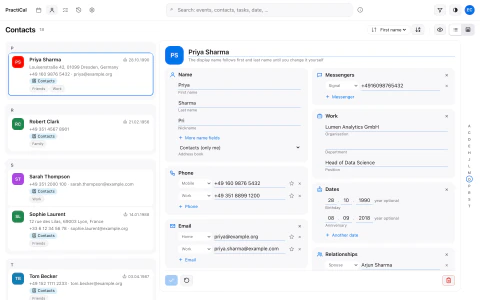</a><br><sub>Contact (edit mode)</sub></td>
</tr>
</table>

<h3>Colours, search, dark mode</h3>
<table>
<tr>
<td align="center" width="25%"><a href="docs/gallery/23-colours.md">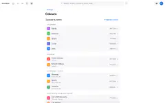</a><br><sub>Colour manager</sub></td>
<td align="center" width="25%"><a href="docs/gallery/24-colour-optimiser.md">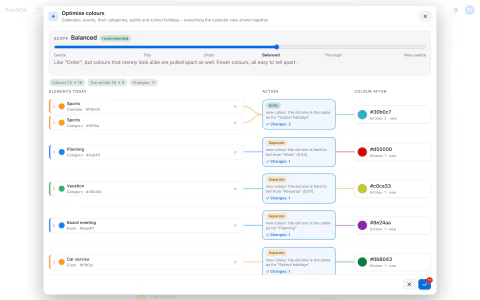</a><br><sub>Colour optimiser</sub></td>
<td align="center" width="25%"><a href="docs/gallery/25-search.md">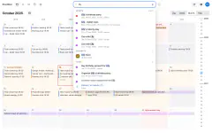</a><br><sub>Universal search</sub></td>
<td align="center" width="25%"><a href="docs/gallery/26-month-dark.md">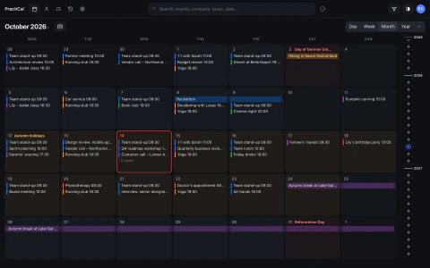</a><br><sub>Month view (dark)</sub></td>
</tr>
</table>

## Quick start on Kubernetes

One pod runs RustiCal (CalDAV/CardDAV, port 4000) and PractiCal (web UI, port 4001) from the same image on one
SQLite volume.

```bash
# 1. get the manifest and put in your two hostnames (web UI + DAV)
curl -LO https://gitlab.com/xarif/docker/practical/-/raw/main/deploy/kubernetes.yaml
sed -i.bak 's/plan.example.com/plan.your.domain/g; s/dav.example.com/dav.your.domain/g' kubernetes.yaml

# 2. deploy
kubectl create namespace practical
kubectl -n practical apply -f kubernetes.yaml

# 3. create the first user (asks for a password)
kubectl -n practical exec -it deploy/practical -c rustical -- rustical principals create alice --password
```

Open `https://plan.your.domain` and sign in. Calendar apps (DAVx⁵, Thunderbird, Apple Calendar) connect to
`https://dav.your.domain` with an app token from **Settings → App tokens**.

> [!tip]
> The manifest expects TLS at the ingress and a default IngressClass (see the comments in
> [`deploy/kubernetes.yaml`](deploy/kubernetes.yaml)). Single sign-on, push reminders, backups and hardening:
> [deployment](docs/deployment.md) and [configuration](docs/configuration.md).

## Documentation

| | |
| --- | --- |
| [Features](docs/features.md) | everything PractiCal does, view by view |
| [Deployment](docs/deployment.md) | production setup: image tags, pod hardening, network, backups |
| [Configuration](docs/configuration.md) | all `PRACTICAL__*` variables, login and SSO, push, holidays, RustiCal settings |
| [Commands](docs/commands.md) | `practical` subcommands, user and group administration with RustiCal's CLI |
| [How it works](docs/architecture.md) | two programs on one database, the image, the RustiCal version contract |
| [Contributing](CONTRIBUTING.md) | local development, tests and gates, CI and releases |
| [Code map](docs/MAP.md) | where every module lives, invariants, caches (for developers and agents) |
| [Performance](docs/performance-2026-10.md) | measurements, release policy, known limits |
| [Licensing](docs/licensing.md) | AGPL-3.0, RustiCal, third-party assets |

## License

[AGPL-3.0-or-later](LICENSE). PractiCal builds on [RustiCal](https://github.com/lennart-k/rustical) (AGPL-3.0-or-later), whose binary ships
unmodified in the image. Details: [docs/licensing.md](docs/licensing.md).
