<!-- docs-nav:top -->

<a href="https://xarif.gitlab.io/docker/practical/"><b>← Back to gallery and documentation</b></a>

<!-- /docs-nav -->

# Features

This page is a guided tour of PractiCal. It shows what each part of the app does, most of it with a screenshot.
Read it to find out whether PractiCal fits your needs, or to discover a feature you have not used yet.

PractiCal is a web app for the calendars, contacts and tasks that [RustiCal](https://github.com/lennart-k/rustical)
stores. It speaks German, English, French and Spanish. It has a light and a dark colour scheme, and it works in
desktop browsers and on phones. All screenshots show synthetic demo data.

> [!note]
> A few terms come up often on this page:
>
> - **CalDAV** and **CardDAV** are the standard protocols that calendar and contact apps use to sync. RustiCal is a
>   CalDAV/CardDAV server.
> - A **DAV client** is any app that syncs this way, for example DAVx⁵ on Android, Apple Calendar or Thunderbird.
> - **iCalendar** (`.ics`) and **vCard** (`.vcf`) are the file formats for events, tasks and contacts.

## The first start

The first time you open PractiCal, it asks one question: your language. The guess comes from your browser, so
usually you only confirm it. Clicking a language shows the question in that language straight away, so you can read
what you are choosing; only the button ends it. The answer decides every word you read afterwards, which is why it
comes first and on its own.

After that a speech bubble points at the settings button and tells you what is still missing: your time zone, the
region for public holidays, the region for school holidays, a calendar and an address book (one of a group you are
in counts too). There is nothing else —
no list to work through and no buttons in the bubble. You go where you like, in any order, and the bubble follows:
it points at the place where that setting lives and walks you there click by click — the settings button, then the
row, then the control. You end up having made the setting yourself, in the place you will find it again next time.
Walk into another unfinished setting and the bubble takes that one up instead.

A bubble has a red edge, because it is not a remark but something waiting for you. It stays until you have answered
that point, and the next one takes its place. When the last one is answered, PractiCal says so once and gets out of
the way.

Answering does not always mean changing something. Taking the time zone that is proposed to you is an answer, and
so is picking a city. For the holidays there is nothing proposed — without a region PractiCal draws no holidays at
all — so the bubble offers to show none, and that is an answer too. The first holiday region you name is copied to
the other list, because one region usually answers both; from then on the two are independent.

Creating your first calendar or address book, PractiCal suggests a name so you need not invent one; clicking the
field hands you the whole word, so typing replaces it.

To walk through the hints again later: **Settings › First steps**.

## Calendar

The calendar has four main views: **Day**, **Week**, **Month** and **Year**. The year view is a planner for the
whole year. Public and school holidays appear in every view.

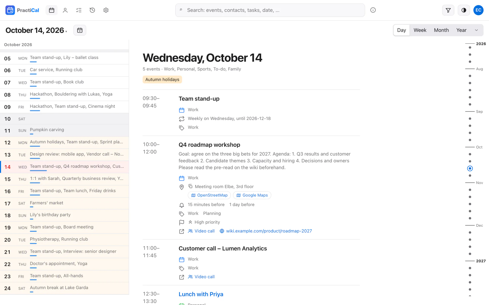

The day view shows today's agenda, a timeline of the day and the month at a glance.

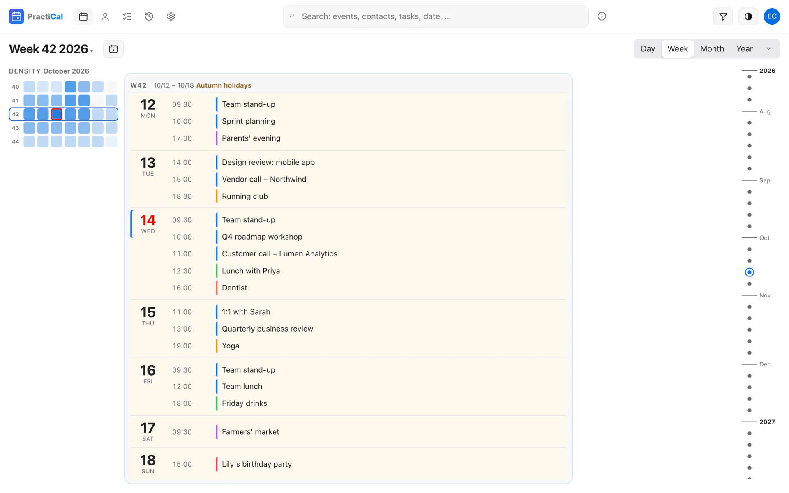

The week view puts overlapping meetings, repeating events and the calendars of the whole family side by side.
An event that lasts several days shows its bar on its first day of the week; a thin line in its color runs down
through the days it lasts.

The month view shows all your calendars at once, together with holidays and events that last several days.

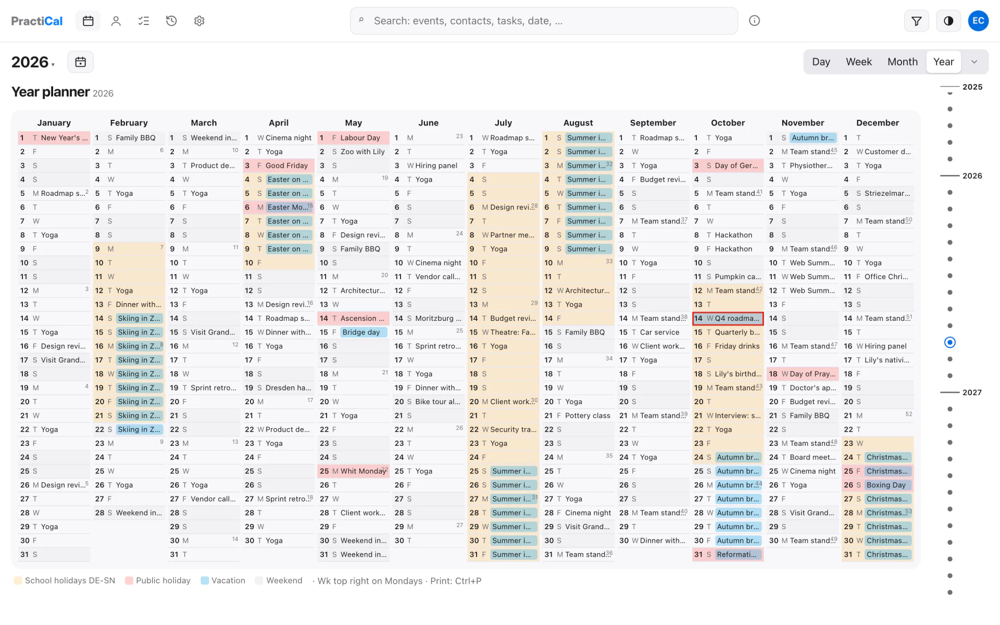

The year planner fits the whole year on one page. It shows public and school holidays, vacations and the first
event of every day.

### Move through time with a swipe

On a trackpad or a touch screen, one swipe moves one month in the month view and one year in the year view. A
sideways swipe switches between views.

### Extra views under "More"

The **More** menu holds four views that answer specific questions about your year.

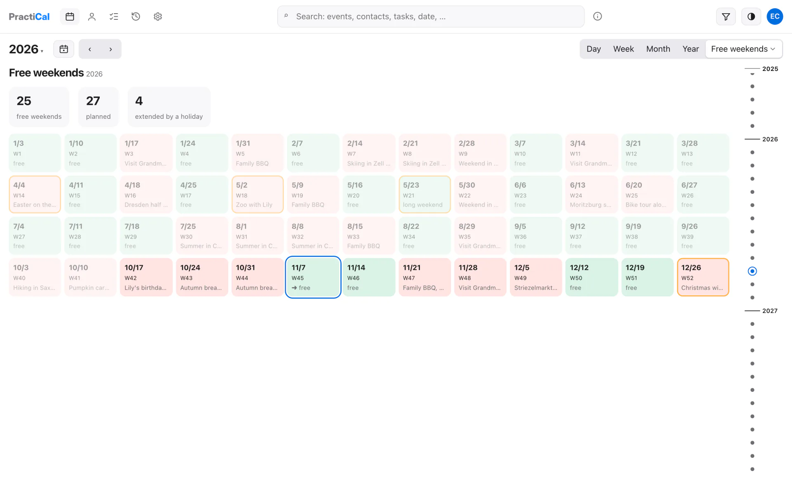

**Free weekends** lists every weekend of the year and shows whether it is free or planned. A weekend that a public
holiday makes longer shows as a long weekend.

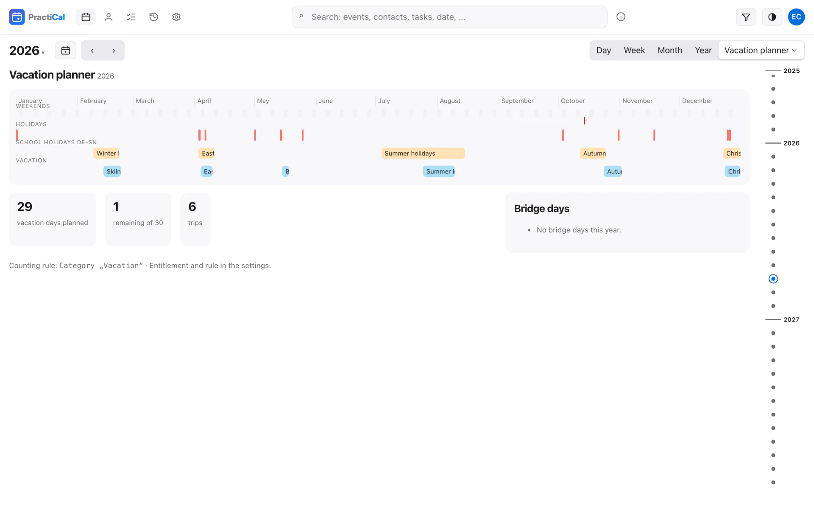

The **vacation planner** counts your vacation days against your yearly entitlement. Weekends and public holidays do
not count. In the settings, you set the entitlement and how PractiCal recognises a vacation: by a category, by a
calendar or by a title pattern.

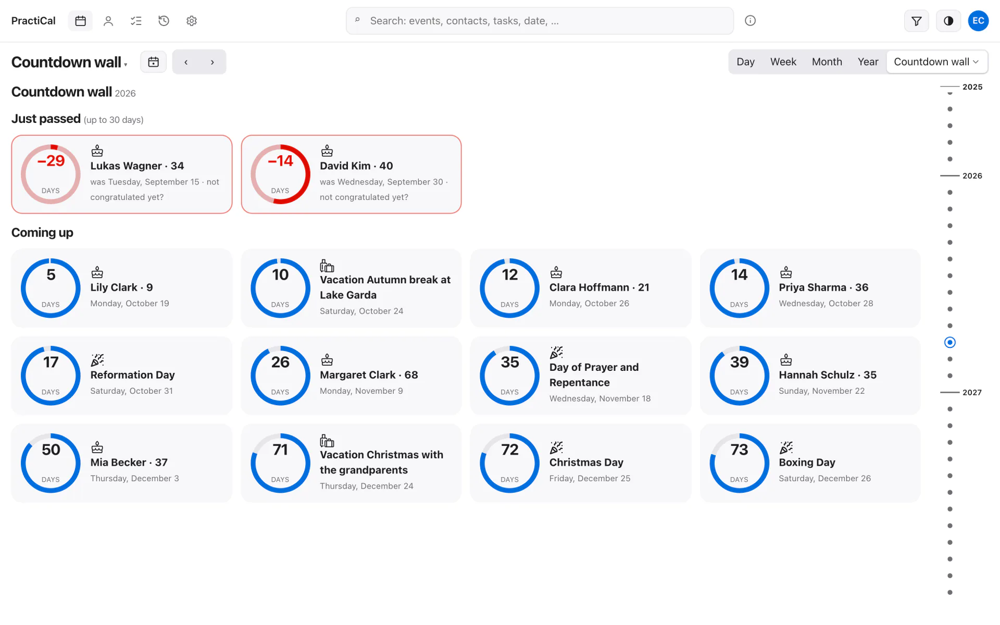

The **countdown wall** shows how many days are left until the next birthdays, vacations and holidays. The birthdays
come from your contacts.

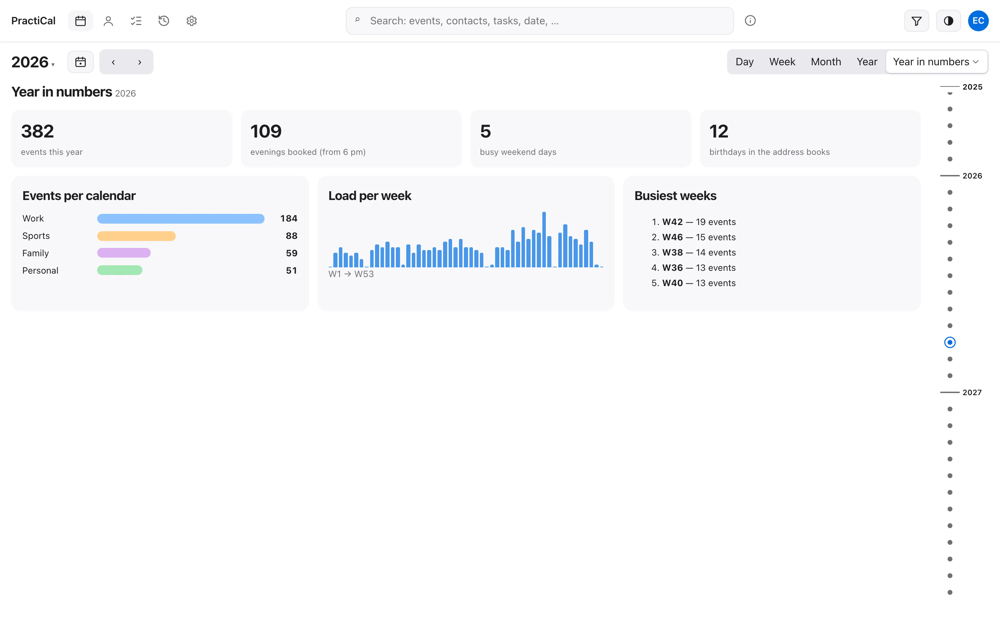

**Year in numbers** shows statistics of the year: events per calendar, the load per week, and busy evenings and
weekends.

### Holidays

PractiCal shows public and school holidays for the regions you pick in the settings. You can pick more than one
region. The first one is your own: vacation days and bridge days count by it.

Where the holiday data comes from, and how to turn it off, is described in
[configuration.md](configuration.md#holidays).

### Live updates

When you change something on your phone or in a desktop app, the change appears in every open PractiCal tab within
seconds. You do not need to reload the page.

## The editor for events and tasks

Events and tasks open in the same editor. It opens in **view mode**, so you cannot change anything by accident. To
edit, select the lock button.

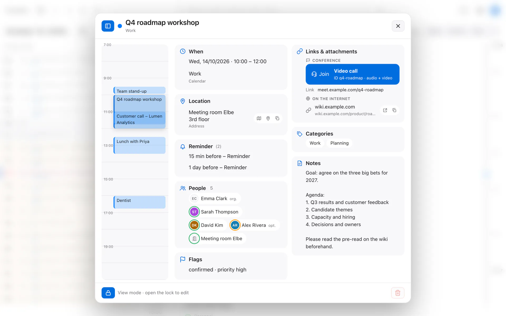

In view mode, the editor shows only the cards that have data. This event has a time, a location, attendees, a video
call, reminders and an agenda in its notes.

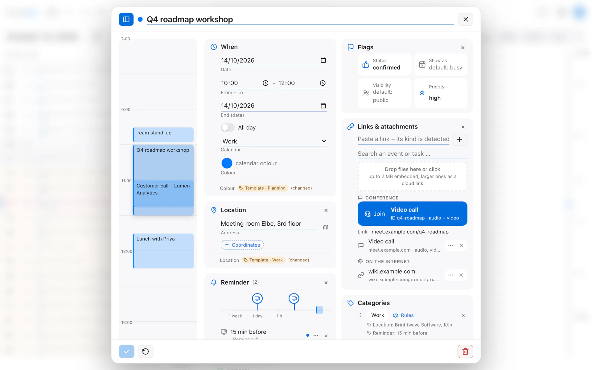

In edit mode, every property is an editable card. **Add card** adds the ones that the event does not have yet. These
are the cards:

- **When**: date, time, all-day, calendar and colour.
- **Location**: an address search with suggestions, and a map.
- **People**: the organiser and the attendees.
- **Reminders**: see [Reminders](#reminders).
- **Repeat**: see [Repeating events](#repeating-events).
- **Links and attachments**: web links, video-call links and files. Files up to 2 MB are embedded. For a larger
  file, add a cloud link instead.
- **Flags**: status, free or busy, visibility and priority.
- **Notes**: free text with mentions. Type `@` for a contact, `#` for a category and `!` for an event.

PractiCal keeps every iCalendar property that it does not show. If another calendar app wrote extra data into an
event, that data is still there after you edit the event in PractiCal.

### Repeating events

The **Repeat** card sets how often an event comes back: daily, weekly, monthly or yearly. A series can run without
an end, or until a date.

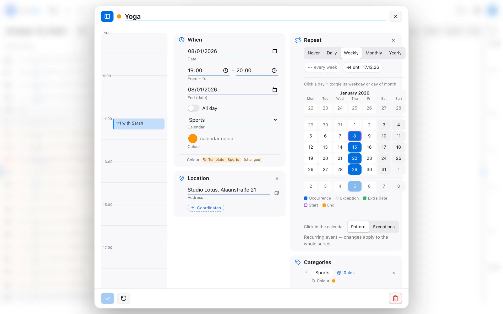

The card has a preview calendar that marks every occurrence. You can click in it in two modes:

- **Pattern**: a click on a day switches its weekday (or its day of the month) on or off.
- **Exceptions**: a click on an occurrence skips that date. A click on a free day adds it as an extra date.

A change applies to the whole series.

### Reminders

The **Reminders** card shows each reminder as a pin on a time strip, for example "15 min before". You can drag a
pin along the strip, or pick one of your presets. The points that the strip snaps to are set in the settings.

PractiCal can also send reminders as browser notifications (Web Push). You switch them on per browser in the
settings. The server needs a key for this: see [configuration.md](configuration.md#web-push-reminders).

### Category rules and title templates

A **category rule** fills in fields for every event or task with a certain category. In the example below, the rule
for "Work" adds a 15-minute reminder and the office address.

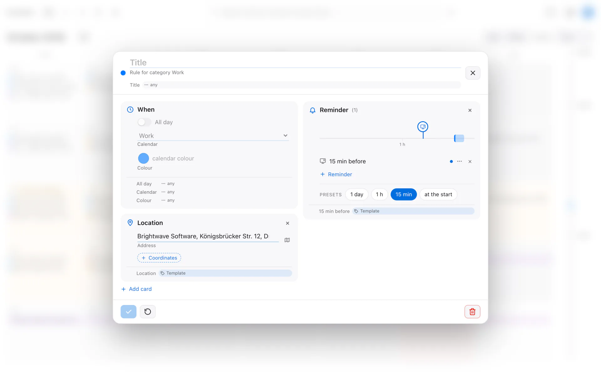

Each field in a rule has one of two modes:

- **Template**: the rule pre-fills the field. You can still change it in the event.
- **Lock**: the rule fixes the field. You cannot change it in the event.

A rule can set fields such as the colour, all-day, reminders, location and priority. There are rules for events and
rules for tasks. If an event has several categories with rules, the category that is higher up in the event wins.
You find the rules under **Settings → Categories**.

> [!note]
> A lock only holds inside PractiCal. Other calendar apps can still change the field.

**Title templates** need no setup. When you type the title of an earlier event, PractiCal offers that event as a
template.

## Tasks

Tasks have six views. All of them share one sort order and one time range.

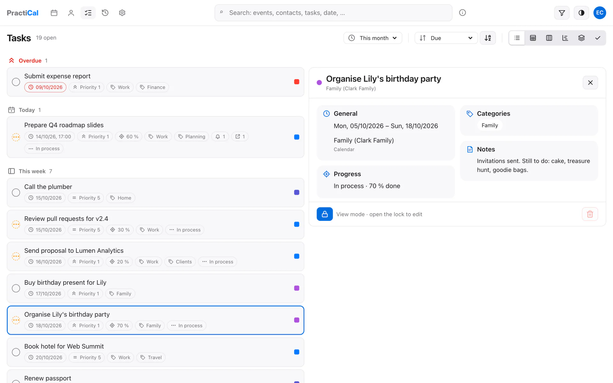

**Groups** sorts tasks by due date: overdue, today, this week, later and so on. The task editor opens beside the
list.

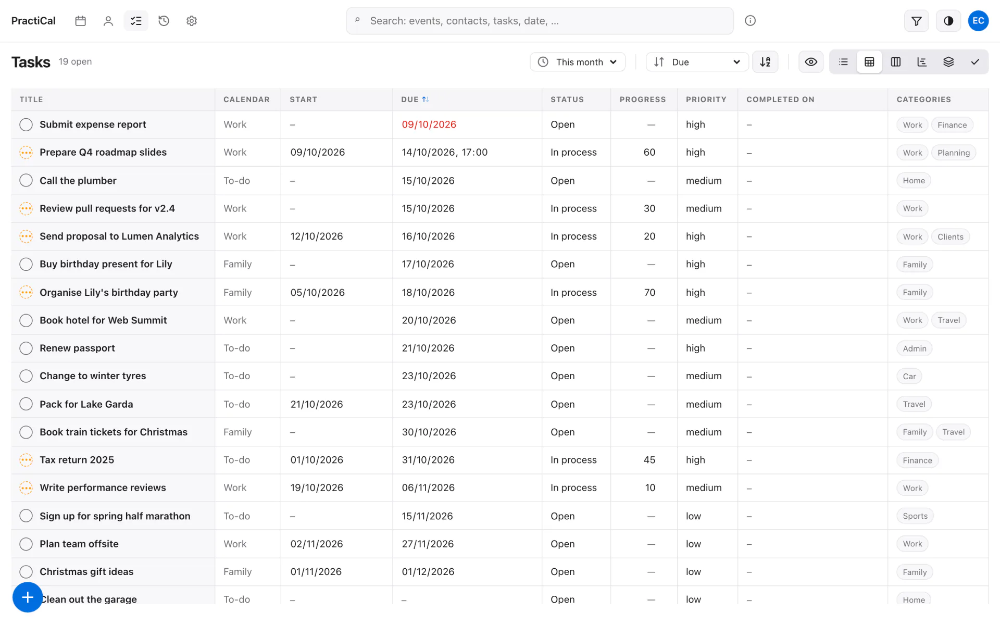

**Table** shows all tasks as a sortable table. You choose the columns.

**Board** is a kanban board with one column per status.

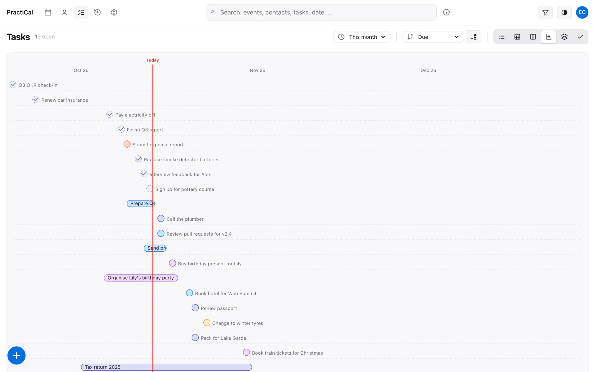

**Timeline** draws tasks that have a start and a due date as bars.

**Cards** shows one task at a time. You work through the deck with the keyboard.

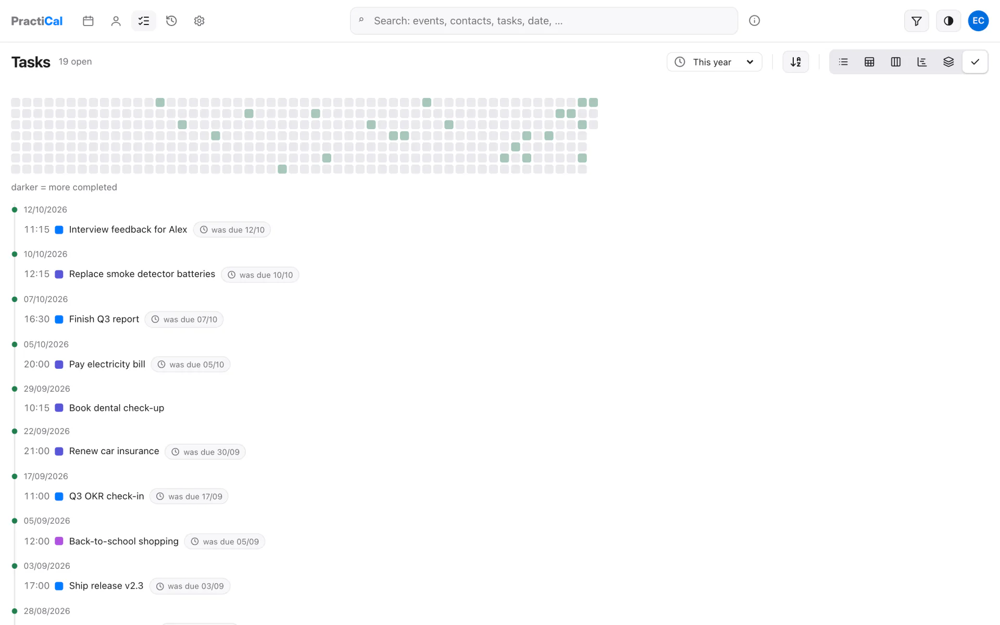

**History** shows the tasks you completed, by day, with a heat map.

A task can have a priority, progress, a start and a due date, a status, categories, a location and links. Tasks open
in the same editor as events.

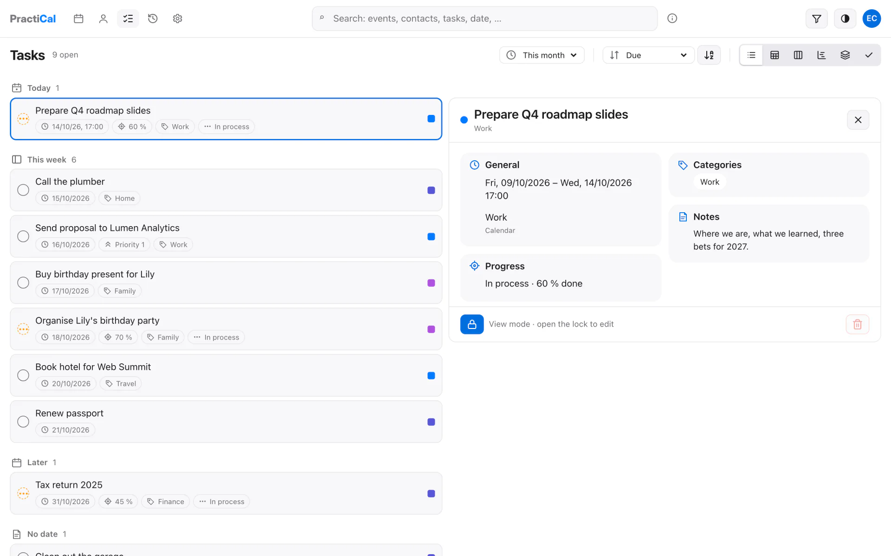

This task is in view mode. It shows its due date, progress, priority, categories, notes and a link to an event.

The same task in edit mode.

## Contacts

The address book is a list or a table. You choose which columns to show and how to sort them. Each address book has
its own colour.

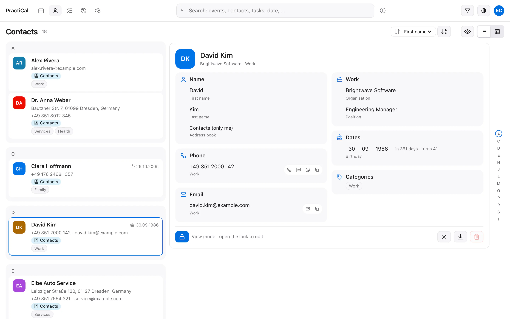

The list has a letter rail for quick jumps. The selected contact opens beside it.

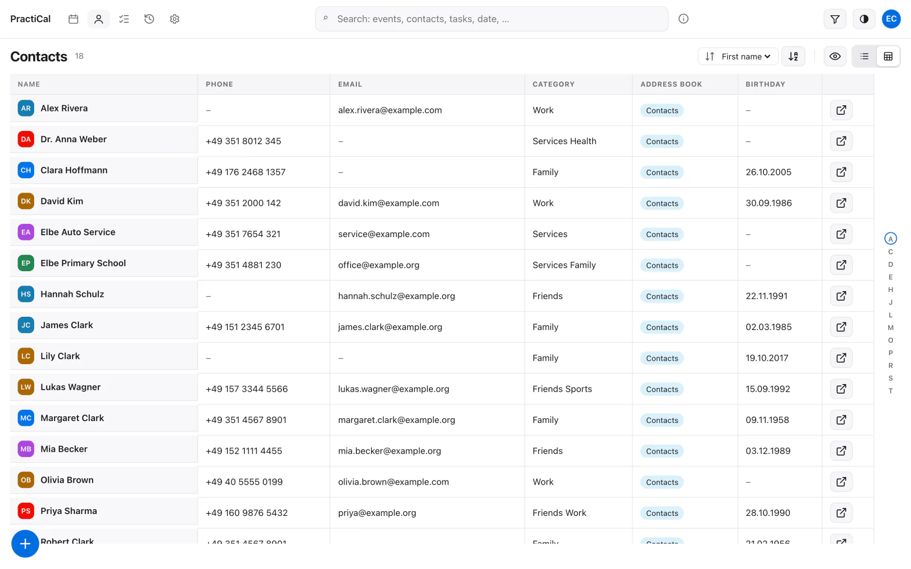

The table shows phone numbers, email addresses, categories and birthdays at a glance.

Contacts open in an editor with a view mode and an edit mode, like events. A contact can have phone numbers, email
addresses, postal addresses, dates, an organisation, messengers, relationships and notes. PractiCal keeps every
vCard property that it does not show.

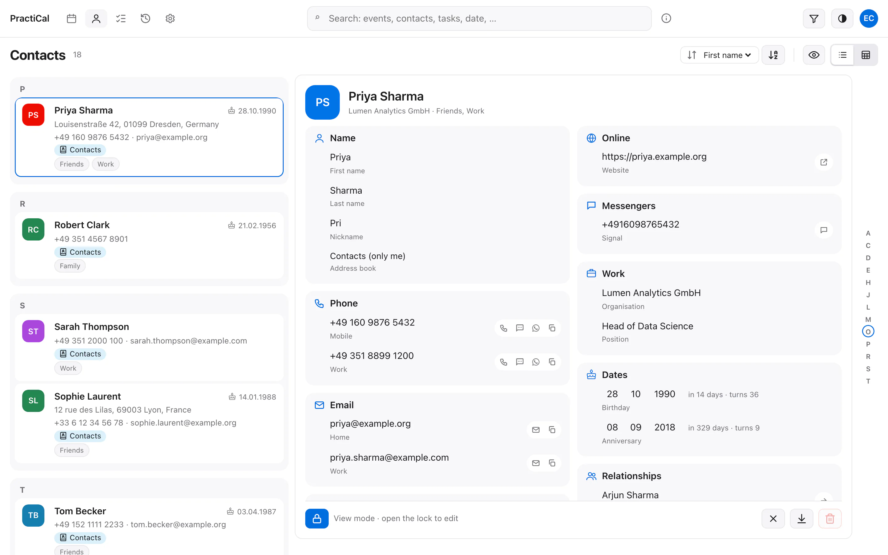

## Search

One search field covers events, contacts and tasks. It understands dates, and it remembers your recent searches.

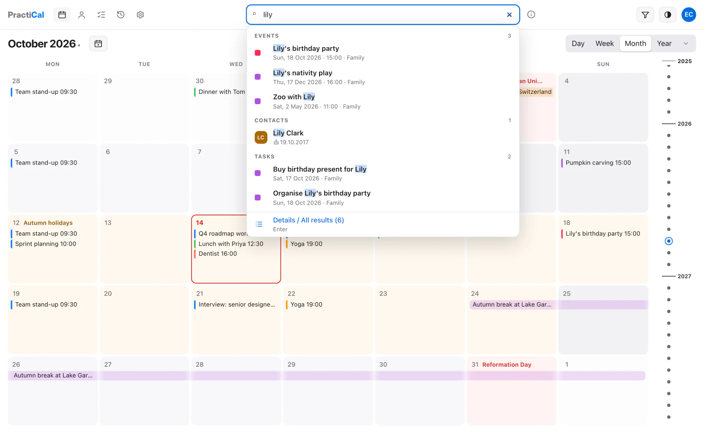

To search only one kind, start with a prefix: `event:`, `contact:` or `task:`. The drop-down shows the top 5 hits
per kind. The full result dialog shows up to 200 hits per kind.

## Colours

The colour manager lists every colour in one place: calendars, categories, events, tasks, holidays and address
books.

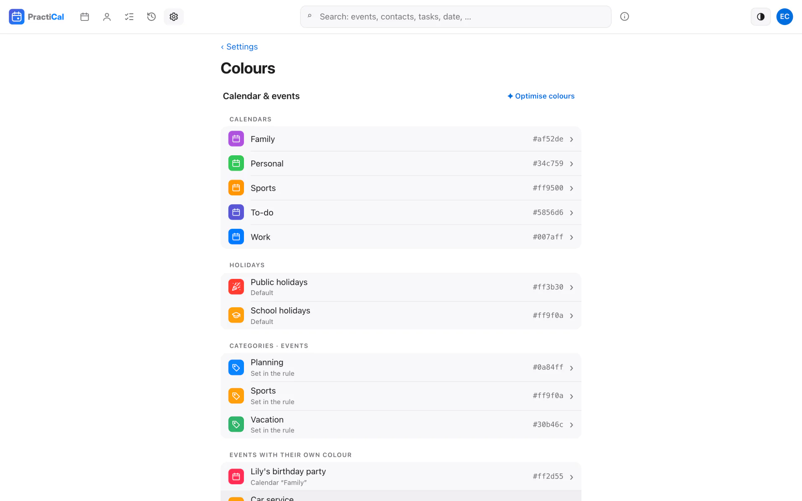

Over time, colours drift apart. The same kind of event ends up in three shades of blue, while two unrelated things
share almost the same green. The **colour optimiser** cleans this up.

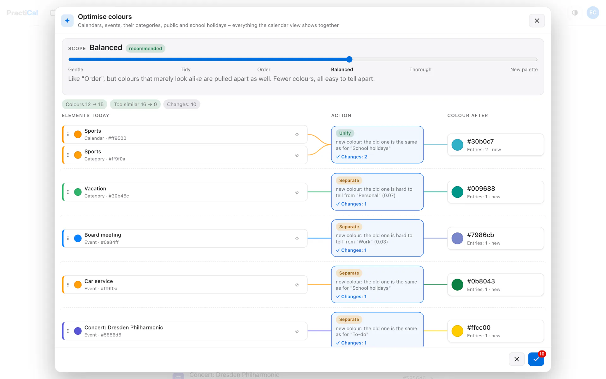

The optimiser has six levels. Each level does more than the one before it.

| Level | What it does |
| --- | --- |
| Gentle | Gives entries with exactly the same title, and events of the same category, one shared colour. Pulls nothing apart. |
| Tidy | Also groups titles with the same word stem ("Holiday", "Holidays") and abbreviations. Pulls apart nearly identical colours of different things. |
| Order | Lets the category, calendar or holidays set the colour of their group. Pulls apart colours that are hard to tell apart. |
| Balanced | Like Order, but also pulls apart colours that merely look alike. |
| Thorough | Also treats title series such as "Project: …" as one group. |
| New palette | Like Thorough, and gives every group a new colour from professional palettes. |

Before anything changes, the optimiser lists every change with its reason. You can drag an element to another
action, or leave it out. Calendars, holidays and colours that someone picked on purpose stay as they are.

## Change history

The change history records every change, whether it came from the browser or from a DAV client. For each change, it
shows which device made it and what changed.

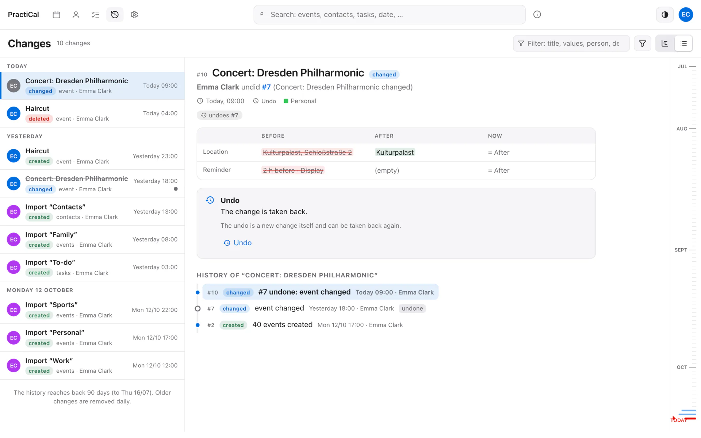

You can undo any change, including a delete. Undo even works after RustiCal has purged a deleted object for good.
An undo is a new change itself, so you can undo it again.

The history has two views: a line map over time, and a list with details. By default, it keeps changes for 90 days.
The server admin can change this period.

## Settings

The settings hold your personal preferences. They are also where you manage calendars, address books and groups.

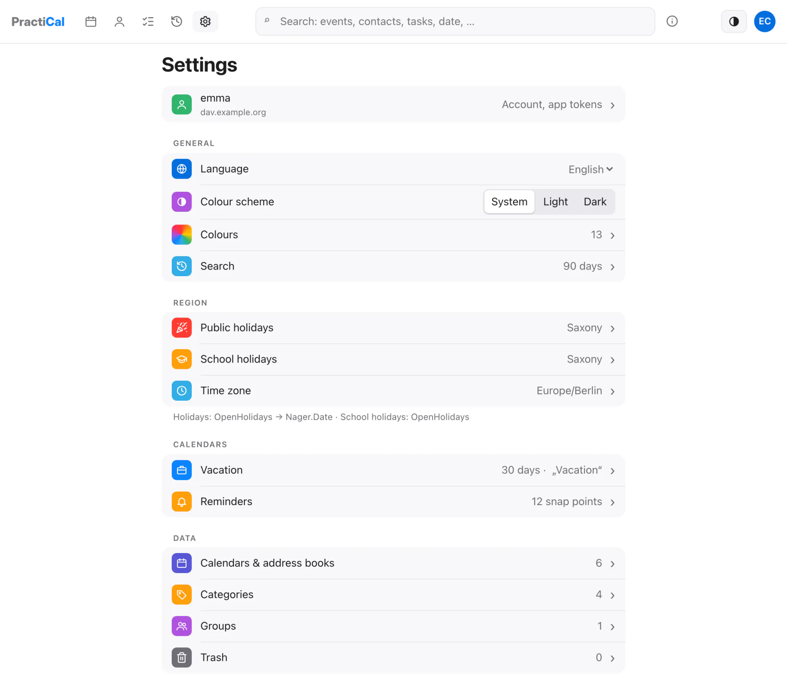

The start page has four sections:

- **General**: language, colour scheme, the colour manager and the search history.
- **Region**: public holidays, school holidays and your time zone.
- **Calendars**: your vacation entitlement and the reminder strip.
- **Data**: calendars and address books, categories, groups and the trash.

### Groups

A **group** is a set of people who share calendars and address books, for example a family. A group belongs to its
members. Every member may add or remove members, create the group's calendars and address books, and delete the
group.

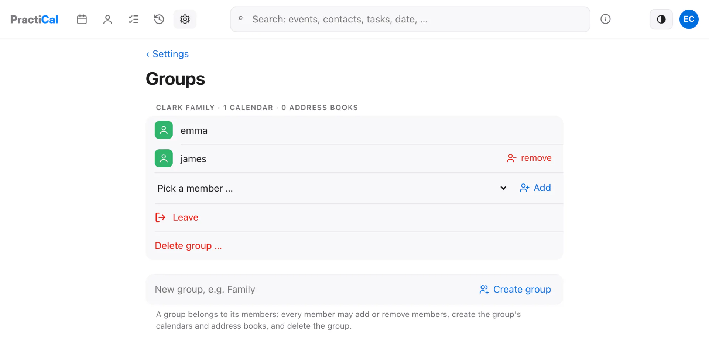

### Calendars and address books

Each calendar and each address book belongs to one person or one group. You can create new ones. You can also import
and export them: calendars as `.ics` files, address books as `.vcf` files.

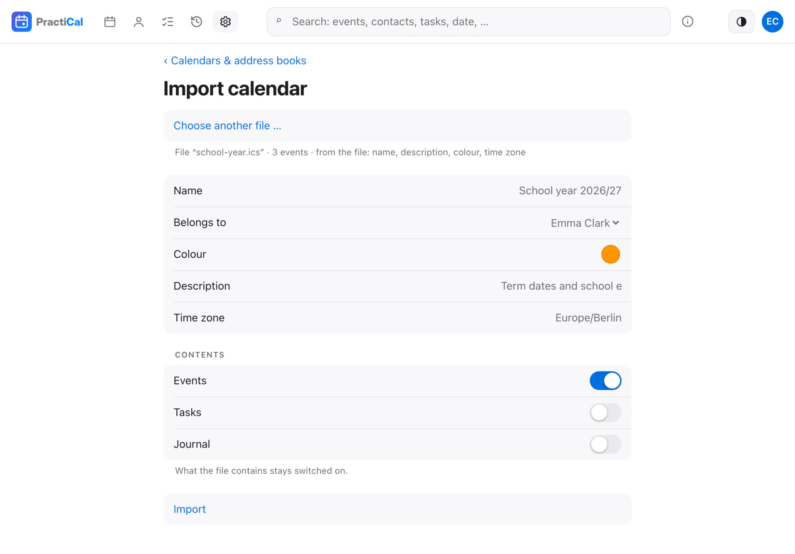

When you import a calendar, PractiCal takes the name, description, colour and time zone from the file, where the
file has them. You can change them before you import. The file can be an export from Google, Apple, Thunderbird or
RustiCal.

### Taking a calendar over from Nextcloud, once or for good

PractiCal can also fetch a calendar or address book straight from another server instead of from a
file. Nextcloud is what this is tested against; the protocol is the standard one, so other servers
speak it too.

You type the address of your server and sign in — in your own browser, at your own server, so a
two-factor code or a single sign-on works as usual and PractiCal never sees your password. Then you
tick the calendars and address books you want. There are two ways to take them:

- **Import** copies them once. Use this when you are leaving the other application behind.
- **Sync** keeps the connection. Changes travel in both directions, every few minutes, and you can
  also set it to only READ from the other server and never write to it.

You also choose who owns what you take over: you, or one of your groups. A group's calendar is
shared with all its members, as if it had been created there. A sync into a group calendar runs on
your sign-in, so it ends when you leave the group or the group goes to the trash.

If both sides changed the same appointment between two rounds, the other server wins — your version
is kept in the change history, where you can bring it back.

Only your OWN calendars are offered. One that somebody shared with you is left out, because the
other server withholds the details of private appointments from anyone but their owner, and a copy
would be quietly incomplete.

### App tokens for calendar apps

Calendar apps on your phone or computer never use your login password. Instead, each device gets its own **app
token**: a password for that one app only. The account page also shows the CalDAV and CardDAV addresses that you
enter in the app.

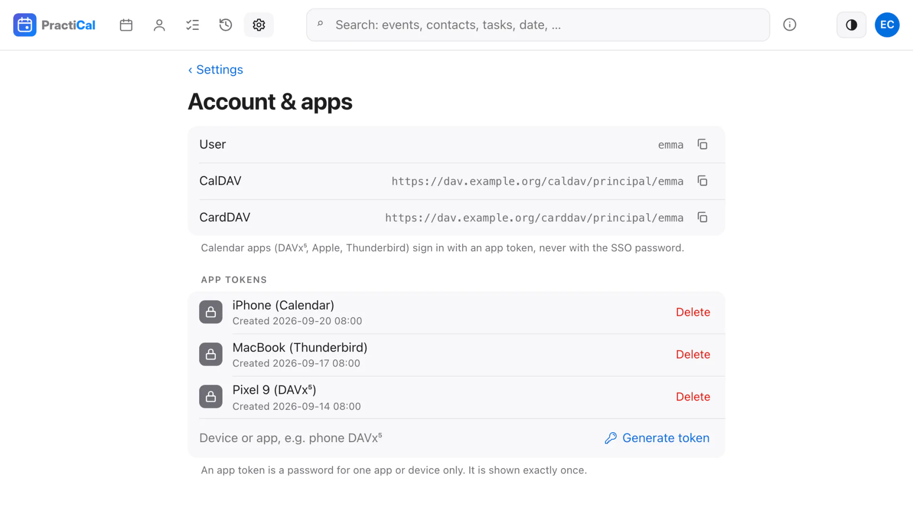

PractiCal shows a new token exactly once, so copy it into the app right away. To lock out a lost device, delete its
token.

### Trash

Deleted groups and calendars go to a trash first, where you can restore them. How long they stay there is set by
the server admin: see `TRASH_RETENTION_DAYS` in [configuration.md](configuration.md#practical-settings).

## Phone and dark mode

On a phone, PractiCal has a tab bar at the bottom and opens editors full screen.

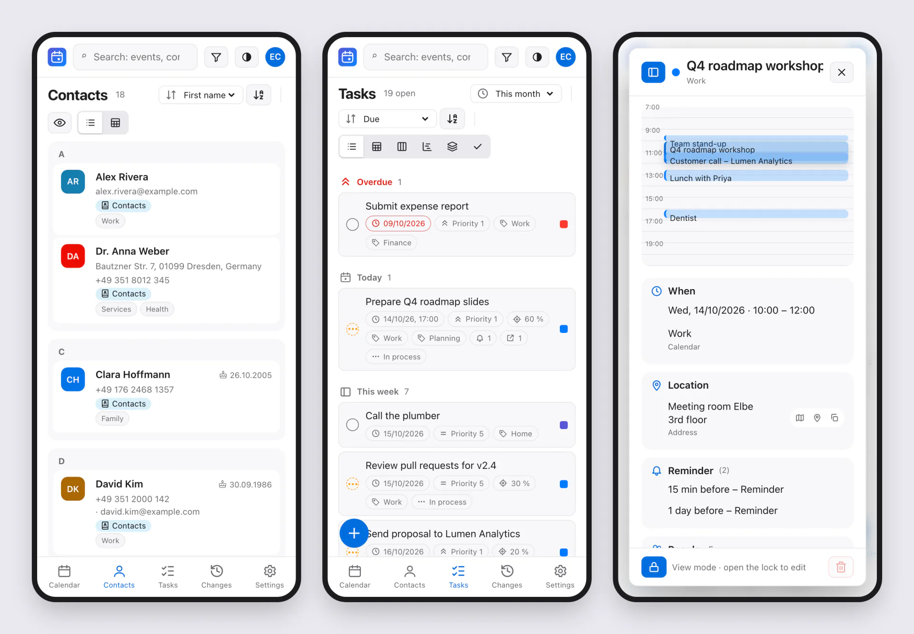

The colour scheme follows your system by default. In the settings, you can also fix it to light or dark.

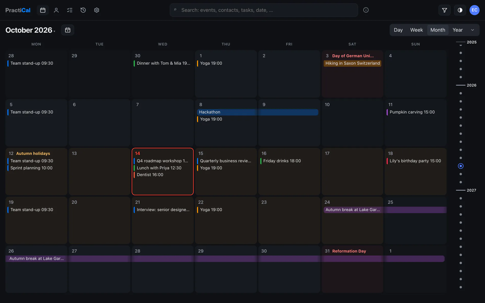

<!-- docs-nav:bottom -->
---

### Documentation

| Guide | What's inside |
| --- | --- |
| [Features](features.md) | everything PractiCal does, view by view |
| [Deployment](deployment.md) | production setup: image tags, pod hardening, network, backups |
| [Configuration](configuration.md) | all `PRACTICAL__*` variables, login and SSO, push, holidays, RustiCal settings |
| [Commands](commands.md) | `practical` subcommands, user and group administration with RustiCal's CLI |
| [How it works](architecture.md) | two programs on one database, the image, the RustiCal version contract |
| [Contributing](../CONTRIBUTING.md) | local development, tests and gates, CI and releases |
| [API documentation](https://xarif.gitlab.io/docker/practical/api/practical/index.html) | the Rust code: request flow, every module, invariants, caches (built from `main`) |
| [Repo overview](repo-overview.md) | how the repo is organised: everything outside the Rust API doc |
| [Performance](performance-2026-10.md) | measurements, release policy, known limits |
| [Licensing](licensing.md) | AGPL-3.0, RustiCal, third-party assets |

<a href="https://xarif.gitlab.io/docker/practical/"><b>← Back to gallery and documentation</b></a>

<!-- /docs-nav -->
