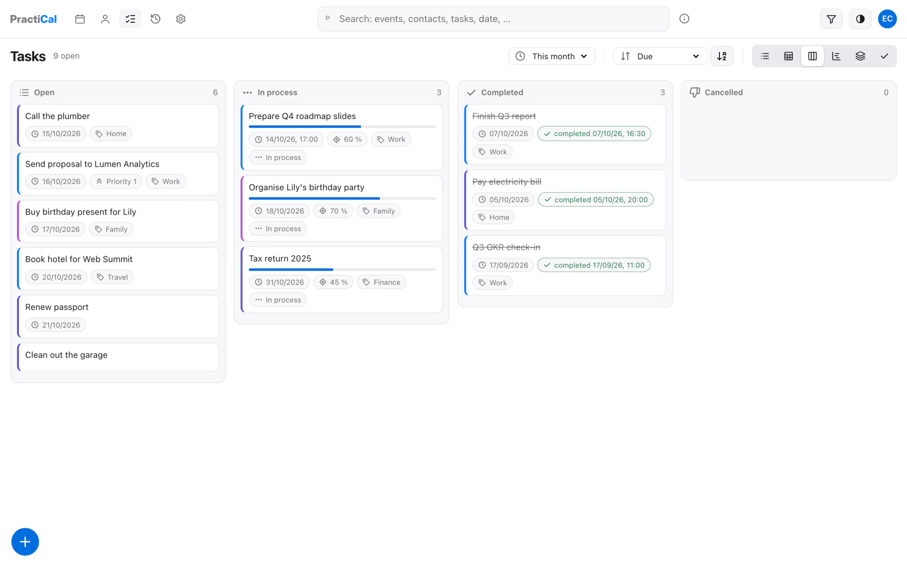

<a href="10-tasks-table.md">◀ Task table</a> · <b>11 / 26</b> · <a href="12-tasks-timeline.md">Task timeline ▶</a> <a href="../../README.md#gallery">all screenshots</a>

## Task board

A kanban board: tasks in columns by status.

<a href="10-tasks-table.md">◀ Task table</a> · <b>11 / 26</b> · <a href="12-tasks-timeline.md">Task timeline ▶</a> <a href="../../README.md#gallery">all screenshots</a>

