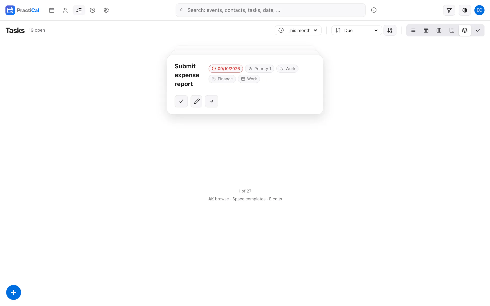

<a href="12-tasks-timeline.md">◀ Task timeline</a> · <b>13 / 26</b> · <a href="14-tasks-done.md">Completed tasks ▶</a> <a href="../../README.md#gallery">all screenshots</a>

## Task deck

One task at a time as a card deck, worked through with the keyboard.

<a href="12-tasks-timeline.md">◀ Task timeline</a> · <b>13 / 26</b> · <a href="14-tasks-done.md">Completed tasks ▶</a> <a href="../../README.md#gallery">all screenshots</a>

