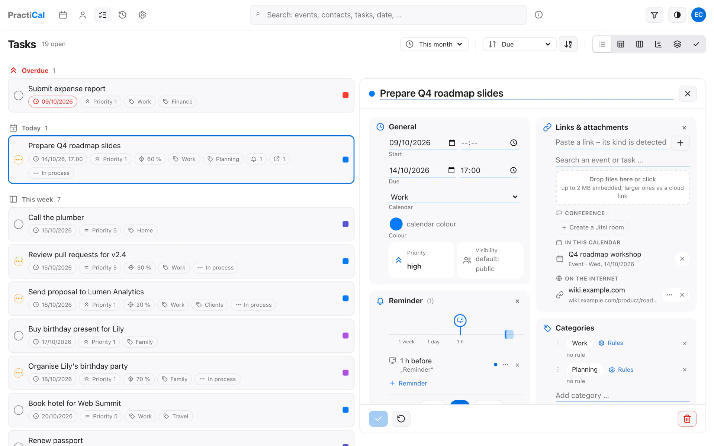

<a href="19-task-view.md">◀ Task (view mode)</a> · <b>20 / 26</b> · <a href="21-contact-view.md">Contact (view mode) ▶</a> <a href="../../README.md#gallery">all screenshots</a>

## Task (edit mode)

The same task in edit mode.

<a href="19-task-view.md">◀ Task (view mode)</a> · <b>20 / 26</b> · <a href="21-contact-view.md">Contact (view mode) ▶</a> <a href="../../README.md#gallery">all screenshots</a>

